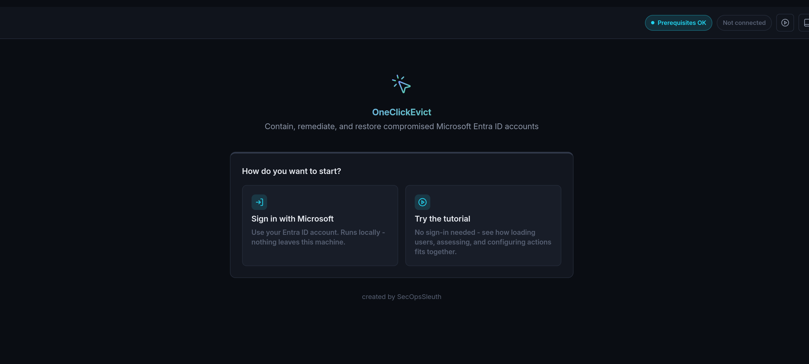
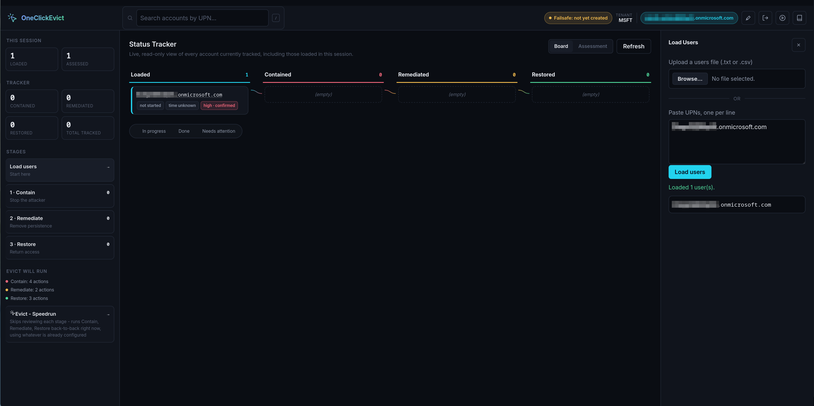
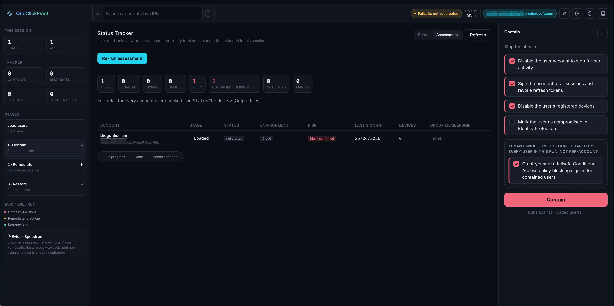
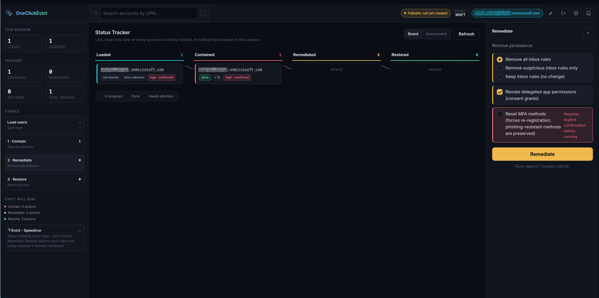
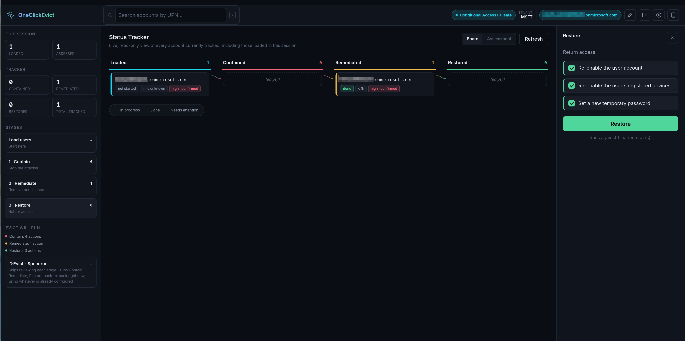
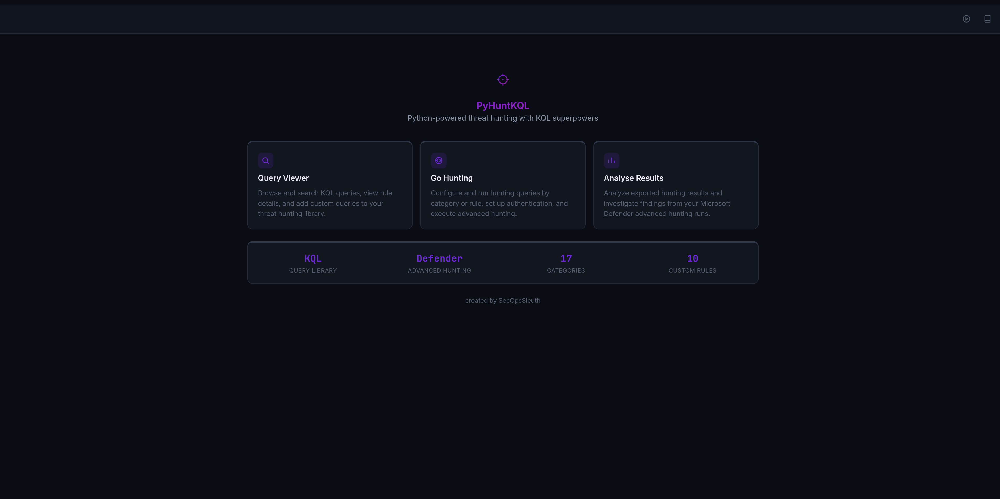
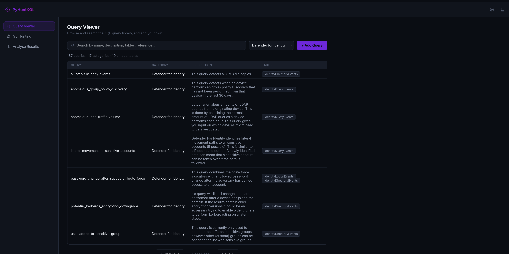
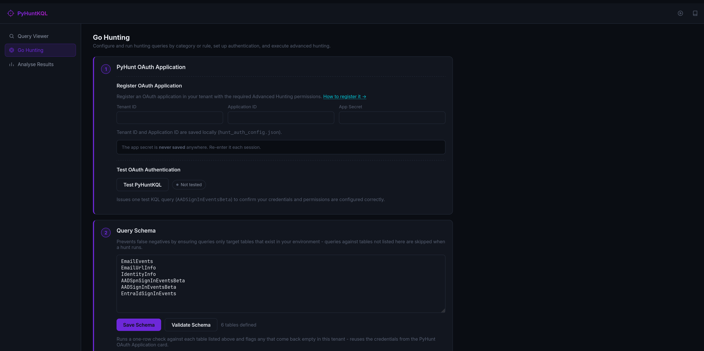
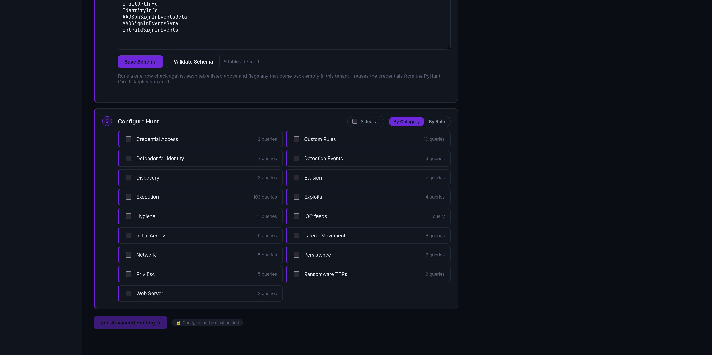
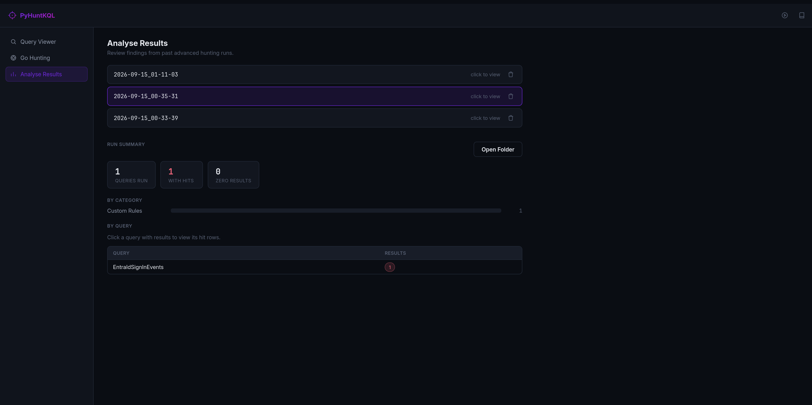

+++
title = 'Tools'
description = 'Cloud incident response tools'
toc = false
+++

Cloud incident response tools.

## Tools overview

| Tool | Purpose | Link |
|--------|----------|---------|
| [OneClickEvict](#oneclickevict) | Contain, remediate, and restore compromised Microsoft Entra ID accounts | *Private* |
| [PyHuntKQL](#pyhuntkql) | Python-powered threat hunting with KQL superpowers | *Private* |

## OneClickEvict

Contain, remediate, and restore compromised Microsoft Entra ID accounts.

Uses Microsoft Graph to automate the response actions for a compromised Entra ID identity. It disables accounts and revokes tokens at scale, uses Conditional Access policies to cover hybrid environments, and tracks remediation through security groups. It also removes malicious inbox rules, registered applications and app consents, and securely resets passwords in bulk.

**Link:** *Private*

### Demo

<video controls preload="metadata" poster="oneclickevict/1-home.png" style="width:100%">
  <source src="oneclickevict/one-click-evict-v1.mp4" type="video/mp4">
  Your browser does not support embedded video.
</video>

*OneClickEvict walkthrough: load users, contain, remediate and restore*

Screenshots (5)

*Home page*

*Load users*

*Configure and run Contain*

*Configure and run Remediate*

*Configure and run Restore*

## PyHuntKQL

Python-powered threat hunting with KQL superpowers.

A validated repository of high-quality KQL hunts, including quick-to-deploy packs for incident response. No SIEM is required: it queries Defender tables directly through the Advanced Hunting API and returns only the hunts with matches. Built-in KQL validation and schema checks mean it only issues hunts that can return results, reducing false negatives. Repeatable hunting as code, with no manual hunting time.

**Link:** *Private*

### Demo

<!-- Placeholder: replace with a <video> block like OneClickEvict's once the PyHuntKQL demo is recorded -->

*Demo video coming soon*

Screenshots (5)

*Home page*

*Query Viewer - KQL detection-as-code threat hunting repository*

*Go Hunting - register OAuth application, apply KQL schema, configure the queries and hunt*

*Analyse Results - see only the matches*

